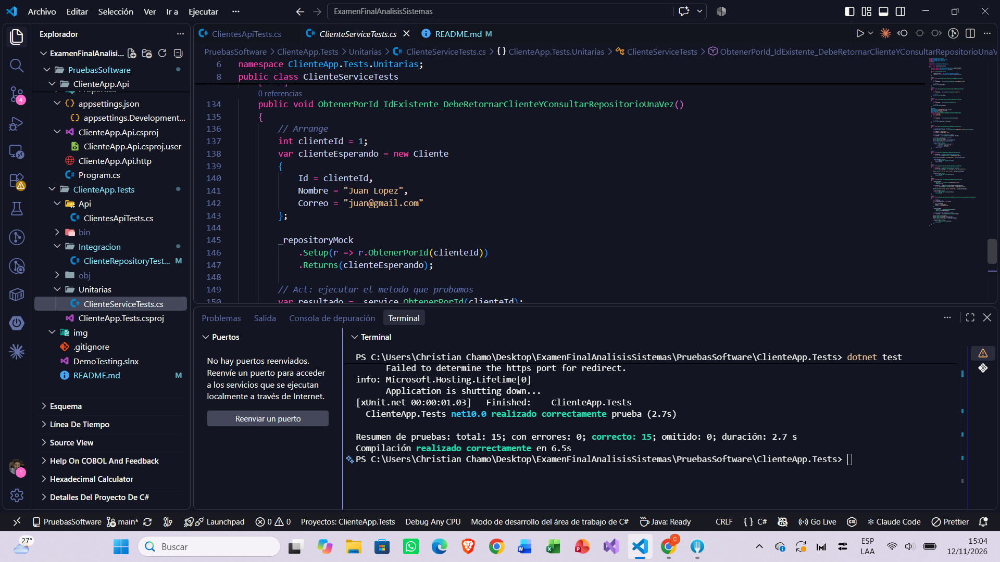
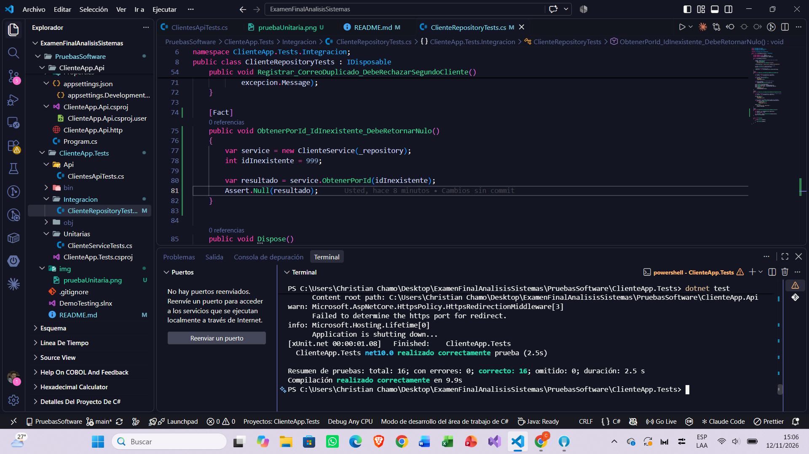
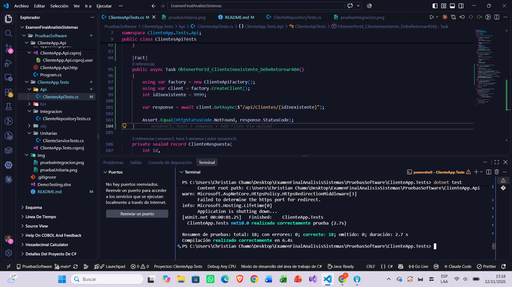

# Documentación de Pruebas - ClienteApp

Este documento describe la suite de pruebas automatizadas implementada para el proyecto **ClienteApp**, abarcando pruebas **unitarias**, de **integración** con SQLite y de **API** mediante `WebApplicationFactory`.

---

## Resumen de Pruebas Nuevas Implementadas

### 1. Pruebas Unitarias (`ClienteServiceTests.cs`)
Diseñadas para aislar la lógica de negocio del servicio utilizando **Moq** para simular el comportamiento del repositorio sin acceder a bases de datos reales.

* **`ObtenerPorId_IdExistente_DebeRetornarClienteYConsultarRepositorioUnaVez`**
  * **Objetivo:** Comprobar que el método `ObtenerPorId` del `ClienteService` devuelve correctamente el cliente esperado cuando este existe.
  * **Validación clave:** Utiliza `Moq` (`.Setup` y `.Returns`) para simular la respuesta del repositorio y `Times.Once` en el `Verify` para asegurar que el repositorio fue consultado exactamente una vez.

  

---

### 2. Pruebas de Integración (`ClienteRepositoryTests.cs`)
Validan la interacción real entre el servicio, el repositorio y una base de datos **SQLite** aislada en archivos temporales o memoria, asegurando la persistencia y el manejo de errores a nivel de datos.

* **`ObtenerPorId_IdInexistente_DebeRetornarNulo`**
  * **Objetivo:** Comprobar que al consultar un identificador que no se encuentra registrado en la base de datos SQLite real utilizando el repositorio y servicio integrados, el sistema devuelve un resultado nulo (`null`).
  * **Validación clave:** Asegura que la consulta de IDs inexistentes no genere excepciones inesperadas y devuelva el flujo correcto.

  


---

### 3. Pruebas de API (`ClientesApiTests.cs`)
Pruebas de extremo a extremo (End-to-End / API) implementadas mediante **`WebApplicationFactory<Program>`** y **`HttpClient`**, levantando un servidor web de prueba en memoria con bases de datos SQLite efímeras.

* **`ObtenerPorId_ClienteExistente_DebeRetornar200`**
  * **Objetivo:** Comprobar que al realizar una petición `GET` a la ruta `/api/Clientes/{id}` para un cliente previamente registrado, la API responde con el código de estado HTTP **200 OK** y la información correcta del cliente.
* **`ObtenerPorId_ClienteInexistente_DebeRetornar404`**
  * **Objetivo:** Comprobar que al realizar una petición `GET` a la ruta `/api/Clientes/{id}` utilizando un identificador que no existe en el sistema, la API responde adecuadamente con el código de estado HTTP **404 Not Found**.

  


---

## Cómo Ejecutar las Pruebas

Para ejecutar toda la suite de pruebas del proyecto y verificar que los resultados sean correctos, sigue estos pasos desde tu terminal:

1. Ubícate en la carpeta raíz de la solución (`PruebasSoftware`) o en el directorio del proyecto de pruebas (`ClienteApp.Tests`).
2. Ejecuta el siguiente comando de .NET CLI:
   ```bash
   dotnet test